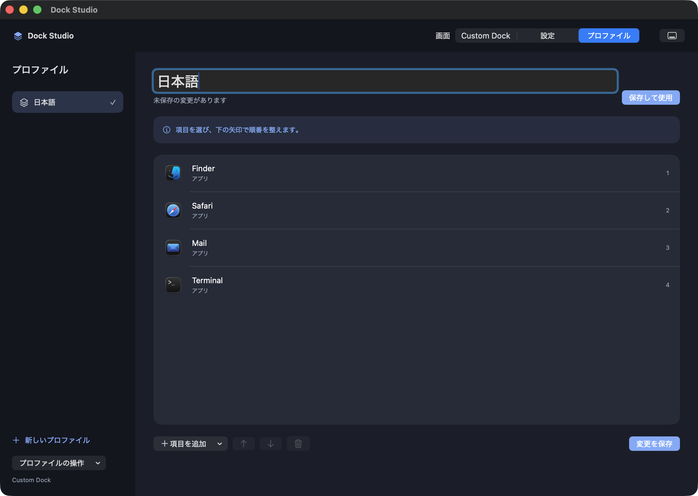
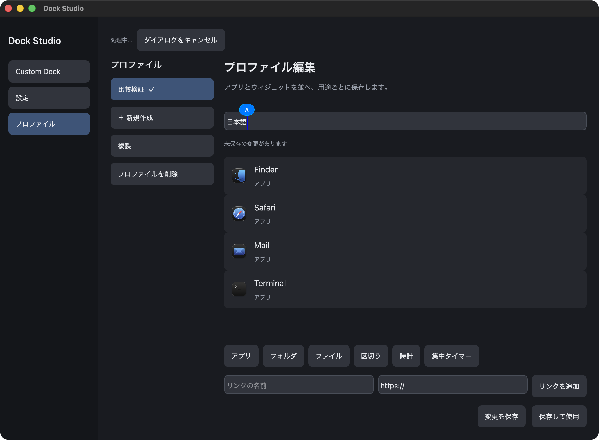
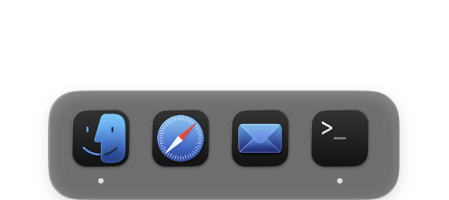
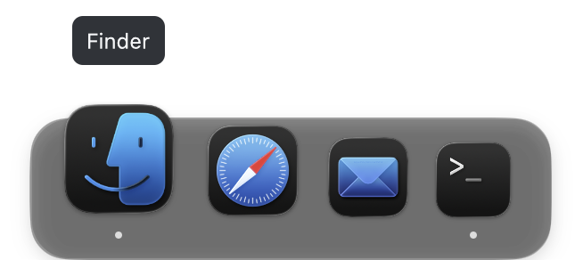
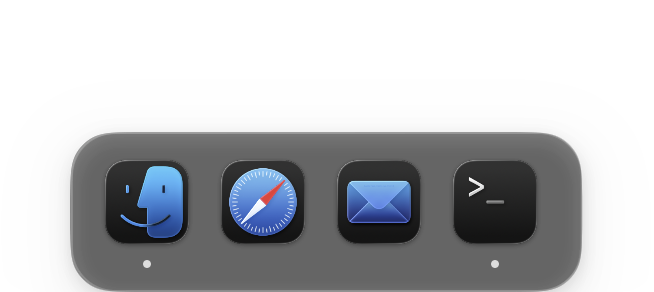
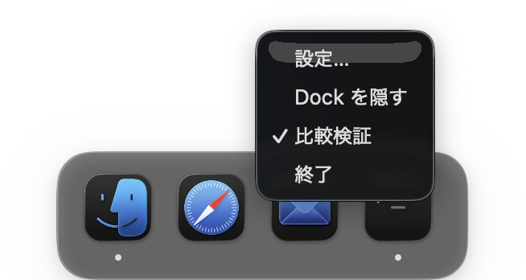

# SwiftUI と GPUI の比較検証

この報告は技術選定前の比較記録である。その後、アプリ全体の完成までは SwiftUI と AppKit を使うと決定した。現在の方針は[実装計画](SWIFTUI_DOCK_PLAN.md)、拡張後の実測は[検証報告](SWIFTUI_VERIFICATION.md)に記載する。

## 目的と進め方

Apple Dock に近い操作感を保ちながら、背景やアイコンを編集できる Dock を作るために比較する。比較検証の結果を確認してから技術を選び、その後で UI を詰める。GPUI への移行を前提にしない。PR #3 は比較対象の試作として扱い、マージしない。

比較対象は現在の SwiftUI 実装と、GPUI 0.2.2 を使った実装である。フレームワーク自体の優劣と、個々の実装の出来を区別する。現在の SwiftUI 版に機能がないことは、SwiftUI で実現できないことを意味しない。

## 検証条件

- 実施日は 2026-10-17 である。
- MacBook Pro、Apple M4 Pro、24 GB、macOS 26.5.2 を使用する。
- SwiftUI は Xcode の Release、GPUI は Cargo の release でビルドする。
- GPUI の常駐 Swift ヘルパーを、CPU とメモリの集計に含める。
- 一時保存先を使う。Finder、Safari、Mail、Terminal の同じ 4 項目を使用する。
- 時計と集中タイマーは配置しない。実行中アプリの追加表示は無効にする。
- 検証用の画面を一時表示する許可を受けている。普段のプロファイルと Apple Dock の設定は変更しない。
- macOS 15 と Intel Mac は、この実機では確認できない。

## 検証項目

| 項目 | 確認方法 |
|---|---|
| 待機時の CPU とメモリ | 同じデータで管理画面を表示し、次に管理画面を閉じて Dock を表示して測定する |
| ホバー | 実ポインタを動かし、描画の変化と使用資源を確認する |
| GPU | Instruments の Metal System Trace で取得できる情報を確認する |
| 日本語入力 | macOS の日本語入力で変換と確定を行う |
| アクセシビリティ | 実ウィンドウの AX ツリーを取得する |
| macOS との連携 | 表示、非表示、右クリック、管理画面を閉じた後の常駐を確認する |
| 開発と保守 | 現在必要なヘルパー、入力部品、OS 連携、依存関係を整理する |

## ビルドと AX の確認結果

SwiftUI と GPUI の Release ビルドは成功した。GPUI の release ビルドは、今回のキャッシュ状態で 4 分 38 秒かかった。異なるキャッシュ状態で実施したため、SwiftUI とのビルド時間比較には使用しない。

実ウィンドウの AX ツリーでは、SwiftUI の画面切り替えやプロファイル名入力欄を取得できた。GPUI では、ウィンドウ枠、閉じるボタン、最大化ボタン、最小化ボタン、タイトルだけを取得できた。これは現在のアプリで確認した差であり、VoiceOver による読み上げ全体の検証は別途必要になる。

現在の SwiftUI 版にはホバー拡大が実装されていない。GPUI 版には隣接アイコンを含む拡大処理がある。背景設定、アイコン加工、起動中の点も実装差に含まれるため、機能数の差を性能の優劣に読み替えない。

公開可能な測定記録は、[検証資料](verification/framework-comparison/summary.json)に保存した。生トレースを含む作業ファイルは、`/tmp/dockstudio-framework-comparison` に残している。技術選定はまだ行っていない。

## フレームワークと現在の実装を分けて考える

| 観点 | SwiftUI 版 | GPUI 版 |
|---|---|---|
| 描画 | SwiftUI の View を NSHostingView で表示する | Rust の View を描画する。GPUI 0.2.2 は macOS で Metal を使用する |
| macOS のウィンドウ | AppKit の NSPanel を直接管理する | objc2 を介して AppKit の NSWindow を管理する |
| 背景のシステム素材 | 現在は ultraThinMaterial を使用する | NSGlassEffectView または NSVisualEffectView を別途配置する |
| 保存とアプリ起動 | 同一プロセス内の Swift の Store を使用する | 常駐する Swift ヘルパーと JSON メッセージで連携する |
| テキスト入力 | SwiftUI の TextField を使用する | GPUI のサンプルを基にした入力部品を保守する |
| 実行中アプリの変化 | NSWorkspace の起動と終了の通知を使う | Swift ヘルパーへの要求を 1 秒ごとに行う |
| ポインタと自動非表示 | 現在の自動非表示確認は 200 ms ごとに行う | ポインタ確認は 100 ms ごとに行う。拡大中は描画フレームを要求する |
| 今回の AX 確認 | 画面内の操作部品と入力値を取得できた | 画面内の操作部品と入力値を取得できなかった |

GPUI の GPU 描画という特徴だけから、SwiftUI より省資源とは判断できない。現在の GPUI 版では、別プロセスと通信、入力部品、macOS 連携も保守対象になる。一方で、描画や配置の細部を Rust 側で直接制御できる。

SwiftUI には状態変化をアニメーションにする仕組みがある。AppKit の View を組み込む NSViewRepresentable も提供されている。したがって、現在の SwiftUI 版にホバー拡大やガラス素材の設定がないことだけを理由に、SwiftUI を候補から外す根拠はない。ただし、今回の検証では SwiftUI に同等のホバー拡大を追加していないため、完成時の性能を実証したことにはならない。

根拠となる一次資料は、[GPUI 0.2.2 の公式ドキュメント](https://docs.rs/gpui/0.2.2/gpui/)、[SwiftUI の Animation](https://developer.apple.com/documentation/swiftui/animation)、[NSViewRepresentable](https://developer.apple.com/documentation/swiftui/nsviewrepresentable)、[SwiftUI のアクセシビリティ](https://developer.apple.com/documentation/swiftui/accessibility-fundamentals)である。

## 入力と実ポインタによる確認

両方のプロファイル名入力欄で、macOS の日本語入力を選択し、物理キーに相当するキーイベントで `nihongo` を入力した。変換と確定後の「日本語」を、SwiftUI では AX の入力値と画像、GPUI では画像で確認した。入力ソースは検証前の ABC に戻した。これは基本的な変換と確定の確認であり、長文、候補選択中の画面遷移、複雑な選択範囲は網羅していない。





GPUI の独立した Dock に実ポインタを移動させ、Finder の拡大、隣接アイコンの拡大、アプリ名の表示を確認した。画像は状態を直接注入する撮影モードを使っていない。





## 測定方法と再現条件

CPU とメモリは、macOS の `proc_pid_rusage` と `RUSAGE_INFO_V2` で 1 秒ごとに取得した。CPU はユーザー時間とシステム時間の差分を、実測した経過時間で割った。CPU の 100% は論理 CPU 1 個を使い切った状態を表す。12 コア全体に対する割合ではない。

メモリは `ri_phys_footprint` の中央値を MiB で示す。GPUI は UI と Swift ヘルパーの値を合算する。プロセスごとの課金値の合計であり、システム全体で重複を除いた物理メモリ使用量ではない。RSS も生データに保存するが、GPU を使うアプリの比較で RSS だけをメモリの指標にしない。

管理画面は、両方とも同じ位置の 1160 × 852 ポイントに揃えた。サイズ変更の非同期反映を画像とウィンドウ情報で確認した。管理画面の集計は両方とも記録の最後の 30 秒を使い、サイズ調整中の区間を除外する。独立した Dock の寸法は実装ごとに異なる。GPUI は拡大用の余白も確保しているため、窓の寸法まで同一の条件ではない。

全画面を隠した常駐と Dock のみの表示は、それぞれ 60 秒測定する。ホバーは実ポインタを同じ範囲で 30 Hz で往復させ、20 秒測定する。現在の SwiftUI 版には拡大がないため、ホバー測定を同じアニメーションの処理性能比較とは扱わない。

この Mac では利用中の他のアプリも動いている。起動順を入れ替えた反復実験、電力とバッテリー消費の測定、熱状態の固定は実施していない。CPU の微小な差を大きな倍率として強調しない。

Release のビルドコマンドは次のとおりである。

```sh
xcodebuild -project DockStudio.xcodeproj -scheme DockStudio -configuration Release \
  -derivedDataPath /tmp/dockstudio-comparison-derived CODE_SIGNING_ALLOWED=NO build
cargo build --manifest-path gpui/Cargo.toml --locked --release -j 2
```

GPUI は Release の実行ファイルと、`swiftc -O` でビルド済みのヘルパーを開発用バンドルへ配置した。SwiftUI と GPUI の両方を同時に起動すると、既存の編集競合防止が働く。画面操作は順番に行ったが、後から検証用プロセスの残留を発見した。そのため、最初の 8 条件は参考記録として扱う。主な判断に使う Dock 常駐の 2 条件は、残留プロセスを終了した後で測り直した。再測定では、起動する試作を 1 個に限定し、GPUI は必要な Swift ヘルパーも含めて集計した。

GPU は次のコマンドを使い、CPU の比較とは別の時間に記録した。

```sh
xcrun xctrace record --template 'Metal System Trace' --attach <UI_PID> \
  --time-limit 10s --output <output.trace>
xcrun xctrace export --input <output.trace> \
  --xpath '/trace-toc/run[@number="1"]/data/table[@schema="metal-gpu-intervals"]' \
  --output <intervals.xml>
```

Instruments の生トレースには環境変数や端末の識別情報も含まれるため、そのまま公開しない。保存する GPU の資料は、対象アプリの実行区間だけを抽出した JSON に限定する。WindowServer による合成処理は対象アプリの GPU 区間だけでは評価できないため、この値を総 GPU 使用率と呼ばない。

## Dock 常駐時の再測定結果

| 条件 | SwiftUI | GPUI と Swift ヘルパーの合計 |
|---|---:|---:|
| CPU の平均 | 0.0034% | 0.1002% |
| メモリの中央値 | 37.9 MiB | 179.9 MiB |
| 測定時間 | 60.20 秒 | 60.23 秒 |

どちらも同じ 4 個のアプリアイコンを表示し、管理画面を閉じた状態で測定した。GPUI は既存の外観設定で `magnification=false` と `runningIndicators=false` にした。SwiftUI 版に未実装の拡大と起動中表示を無効にしても、今回の測定では GPUI 版のメモリ使用量が多かった。ただし、背景素材や描画経路まで同一にした実験ではない。

CPU は両方とも低い。GPUI 版を省 CPU とする根拠は得られなかったが、この小さな CPU 使用率の比を、体感速度やバッテリー消費の倍率には読み替えない。メモリの差は約 142 MiB であり、常駐アプリとして採用を判断する際に考慮する必要がある。

再測定の生データは、[SwiftUI](verification/framework-comparison/swiftui-control-dock.jsonl)と[GPUI](verification/framework-comparison/gpui-control-dock.jsonl)に保存した。

### 初回測定の参考記録

| 状態 | SwiftUI の CPU | GPUI の CPU | SwiftUI のメモリ | GPUI のメモリ |
|---|---:|---:|---:|---:|
| 管理画面のみ、最後の 30 秒 | 0.019% | 0.098% | 58.1 MiB | 191.8 MiB |
| 管理画面と Dock を隠して常駐、60 秒 | 0.009% | 0.074% | 60.4 MiB | 106.5 MiB |
| Dock のみ、60 秒 | 0.003% | 0.103% | 62.1 MiB | 208.5 MiB |
| ポインタを往復、20 秒 | 0.034% | 0.576% | 62.1 MiB | 210.5 MiB |

この表は、検証用プロセスの残留や、先行する操作で保持された描画資源の影響を分離できていない。初回と再測定の差を、外観設定だけの効果として説明しない。また、SwiftUI はホバー拡大を処理していないため、ホバー行は同じ機能の性能比較ではない。

## GPU と応答時間について分かった範囲

両方に Metal System Trace を実施し、記録と書き出しは成功した。GPUI の対象プロセスには、深さ 0 の GPU 区間が 73 件あり、区間時間の合計は約 4.68 ms だった。SwiftUI の対象プロセスに帰属する同じ形式の区間は 0 件だった。

これは、SwiftUI の GPU 使用量がゼロという結果ではない。WindowServer などへの処理の帰属が異なるため、対象プロセスの Metal 区間だけでは公平な GPU 負荷の比較にならない。GPU 使用率の優劣は未判定とする。抽出結果は、[GPUI](verification/framework-comparison/gpui-gpu-filtered.json)と[SwiftUI](verification/framework-comparison/swiftui-gpu-filtered.json)に保存した。

GPUI のホバー拡大と自動非表示の動作は目視で確認したが、入力から画面表示までの遅延やフレーム落ち率は数値として測定できていない。コードのアニメーション時間を、実測した応答時間として報告しない。

## macOS との連携の確認結果

| 項目 | SwiftUI | GPUI |
|---|---|---|
| 管理画面を閉じても Dock を表示する | 確認した | 確認した |
| 自動非表示とポインタによる再表示 | 確認した | 確認した |
| 日本語 IME の基本的な変換と確定 | 確認した | 確認した |
| 画面内の入力欄を AX で取得する | 確認した | 取得できなかった |
| 実ポインタによるホバー拡大 | 現在の実装にはない | 確認した |
| 右クリックメニューの実表示 | 今回は未検証である | 確認した。項目の実行までは網羅していない |
| OS から終了要求を送った後のプロセス終了 | 確認した | 確認した |

SwiftUI の自動非表示では、Dock の窓が 100 × 8 ポイントになり、ポインタを重ねると 272 × 78 ポイントへ戻った。[折りたたみ時](verification/framework-comparison/swiftui-collapsed-windows.json)と[再表示時](verification/framework-comparison/swiftui-revealed-windows.json)の記録を残した。

GPUI は 327 × 146 ポイントの窓を保持したまま内容を隠し、画面端にポインタを移動すると Dock を再表示した。両方の画像は実操作後に撮影した。






終了の確認では、対象 PID を指定した NSRunningApplication の終了要求を使い、実際にプロセスが消えたことを確認した。自動操作でメニューを選択したという結果だけでは、終了成功と扱っていない。途中で残留した検証用プロセスは個別に終了し、検証終了時には試作と Swift ヘルパーが残っていないことを確認した。

## 技術選定に渡す結論

**現在の実装で「GPUI の方が軽い」とする根拠は得られなかった。macOS 専用の常駐 Dock という要件では、SwiftUI と AppKit を継続する案を第一候補にすることを提案する。これは採用の確定ではない。**

| 選択肢 | 今回の根拠と、選ぶ場合の次の作業 |
|---|---|
| SwiftUI と AppKit を継続する | 今回の Dock 常駐測定ではメモリ使用量が小さく、画面内の AX と標準入力部品を利用できる。Apple Dock に近い拡大、背景設定、アイコン加工を追加し、同じ機能を持つ状態でも性能を確認する |
| GPUI を採用する | 独自の拡大、配置、外観設定の試作は動いている。採用理由は描画制御や Rust を使う価値として説明する必要がある。AX、保持する描画資源、ヘルパー連携を含む保守負担への対応が必要になる |

どちらを選んでも、Apple Dock らしい外観や動きは別途 UI として詰める必要がある。現在の画面の完成度だけで、フレームワークの表現力を決めない。

### 選定前後に残る検証

- GPU 全体の公平な比較と、同じアニメーションに対する応答時間を測定する必要がある。
- VoiceOver の実際の読み上げは、両方で網羅していない。GPUI の画面内の AX 不足は確認済みであり、一般向け配布に進む前に対応が必要になる。
- Spaces、全画面、ディスプレイの抜き差し、透過領域の背面操作を確認する必要がある。
- 長文の日本語入力、候補選択中の操作、標準ファイルダイアログとの往復は未検証である。
- macOS 15 と Intel Mac は別環境で確認する必要がある。
- 電力、バッテリー消費、起動順を変えた反復測定は未実施である。

検証後の技術選定を待つ。UI の追加実装と PR のマージは行っていない。

## 測定用コード

次のコードを `measure.c` に保存し、`xcrun clang -O2 measure.c -o measure` でビルドした。`./measure 60 <UI_PID> <HELPER_PID>` のように実行する。SwiftUI ではヘルパーの PID を省略する。

```c
#include <libproc.h>
#include <sys/resource.h>
#include <stdio.h>
#include <stdlib.h>
#include <time.h>
#include <unistd.h>
int main(int argc, char **argv) {
    if (argc < 3) { fprintf(stderr, "Usage: measure seconds pid [pid...]\n"); return 2; }
    int seconds = atoi(argv[1]);
    for (int i = 0; i <= seconds; i++) {
        struct timespec ts; clock_gettime(CLOCK_MONOTONIC, &ts);
        printf("{\"t\":%.9f,\"processes\":[", ts.tv_sec + ts.tv_nsec / 1e9);
        for (int j = 2; j < argc; j++) {
            struct rusage_info_v2 r = {0};
            int pid = atoi(argv[j]);
            if (proc_pid_rusage(pid, RUSAGE_INFO_V2, (rusage_info_t *)&r)) { perror("proc_pid_rusage"); return 1; }
            printf("%s{\"pid\":%d,\"cpu_ns\":%llu,\"rss\":%llu,\"footprint\":%llu,\"idle_wakeups\":%llu,\"interrupt_wakeups\":%llu}", j==2 ? "" : ",",pid,r.ri_user_time+r.ri_system_time,r.ri_resident_size,r.ri_phys_footprint,r.ri_pkg_idle_wkups,r.ri_interrupt_wkups);
        }
        puts("]}"); fflush(stdout);
        if (i < seconds) sleep(1);
    }
    return 0;
}
```
