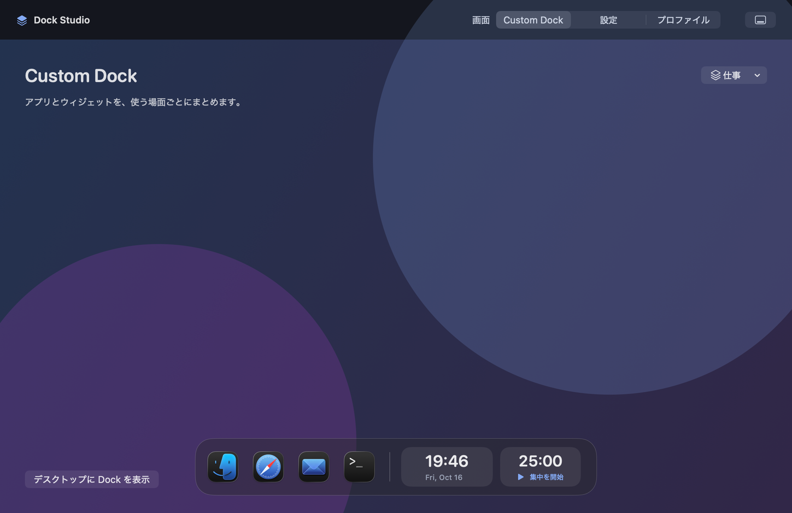
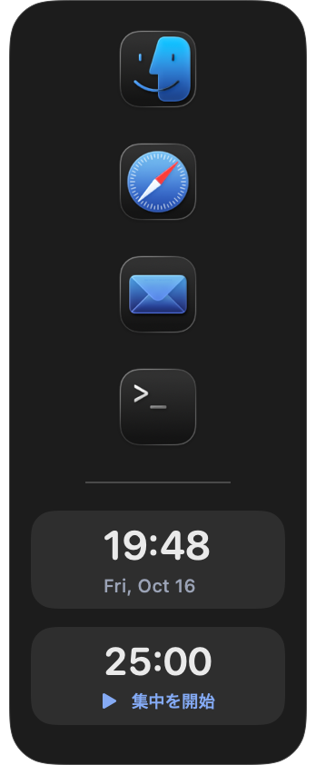
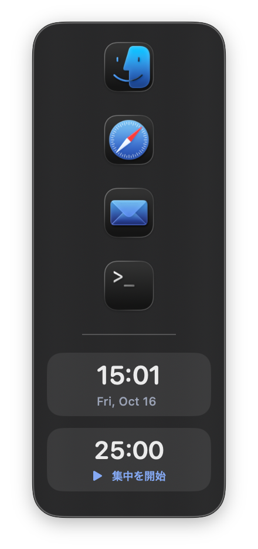
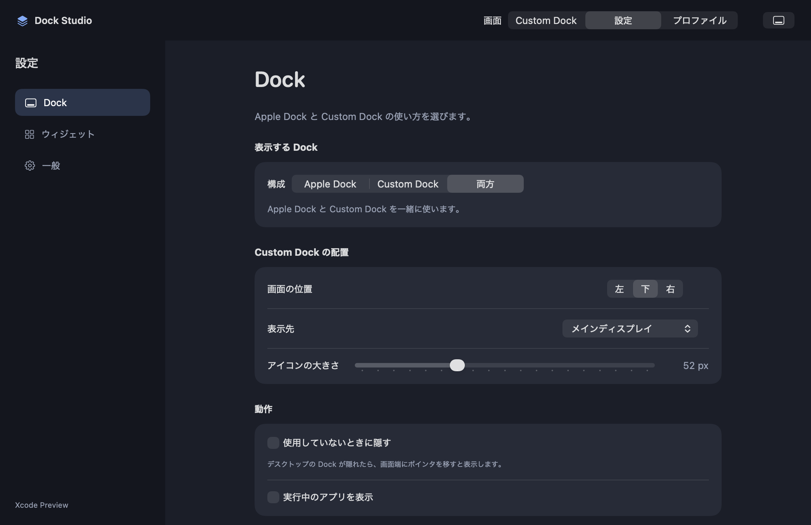
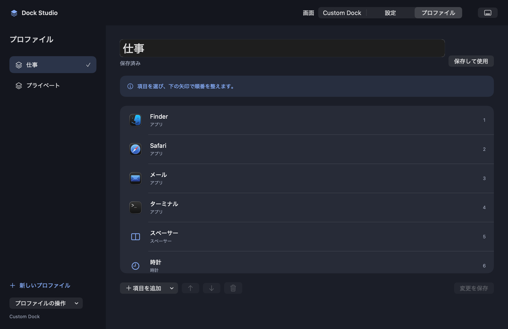

# 保存基盤と Custom Dock の検証

## 自動テスト

macOS 26.5.2、Apple Silicon、Xcode 26.6 で、レビュー修正後の44件のテストが成功した。Xcode のアプリビルドも成功した。

```bash
swift test --scratch-path /tmp/dockstudio-headless-tests
xcodebuild -project DockStudio.xcodeproj -scheme DockStudio -configuration Debug -destination 'platform=macOS,arch=arm64' -derivedDataPath /tmp/dockstudio-derived CODE_SIGNING_ALLOWED=NO build
```

保存後の再読み込み、編集用の下書き、壊れた設定の保護、将来の形式の保護、書き込み失敗時の状態保持、インポート、削除取り消し、タイマーの経過時間を確認した。

レビュー修正後のテストはアプリのエントリーポイントを含めず、画面に管理画面や Dock を表示せずに実行した。[全10件の修正結果](REVIEW_FIXES.md)に確認範囲を記載した。

## 実画面の確認

レビュー修正前に、専用の一時保存先を使って実行した。プロファイル名を管理画面から変更し、JSON の保存結果とアプリ再起動後の復元を確認した。

右端に表示した独立 Dock は、幅174px、高さ421pxだった。自動非表示を有効にすると幅8px、高さ100pxのハンドルになり、ポインタを重ねると元のサイズに戻った。

Apple Dock の読み取り処理は、実際の環境で11項目を取得した。Apple Dock の設定への書き込みは行っていない。

## 画面の記録

管理画面3枚は、レビュー修正後の実際の SwiftUI ビューを画面外の AppKit ウィンドウで描画して撮影した。保存先を持たないプレビュー用ストアを使い、通常のデスクトップに画面を表示せず記録した。撮影用コードでは、最初に選ぶタブだけを指定できるようにした。

[表示変化の動画](media/state-demo.mp4)は、実際のストアの設定変更、プロファイル作成、名前変更、項目追加、保存を実行した後の画面を1秒ごとに記録したものである。マウス操作の録画ではなく、デスクトップ上での自動非表示やメニュー操作の確認を代替しない。

独立した Dock の最新版も同じ方法で撮影した。撮影用コードでは、内部のビューを参照できるようにアクセス範囲だけを変更した。以前の実機での画像も履歴として残している。

### Custom Dock



### 独立した Dock の最新版



### レビュー修正前のデスクトップ上の記録



### 設定



### プロファイル編集



## 残っている確認

- macOS 15 の実機と Intel Mac で確認する。
- 複数ディスプレイの抜き差しとフルスクリーンで確認する。
- ファイル選択、書き出し、読み込みのダイアログ操作を確認する。
- 実際のアプリ起動とリンク表示を確認する。
- Xcode Canvas 内の対話操作を確認する。
